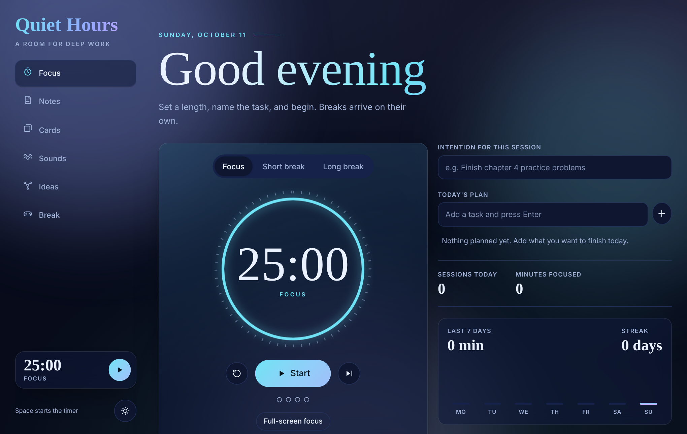
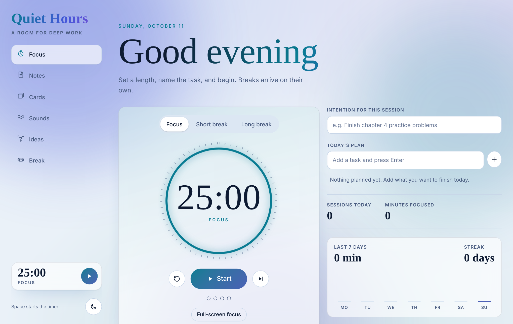
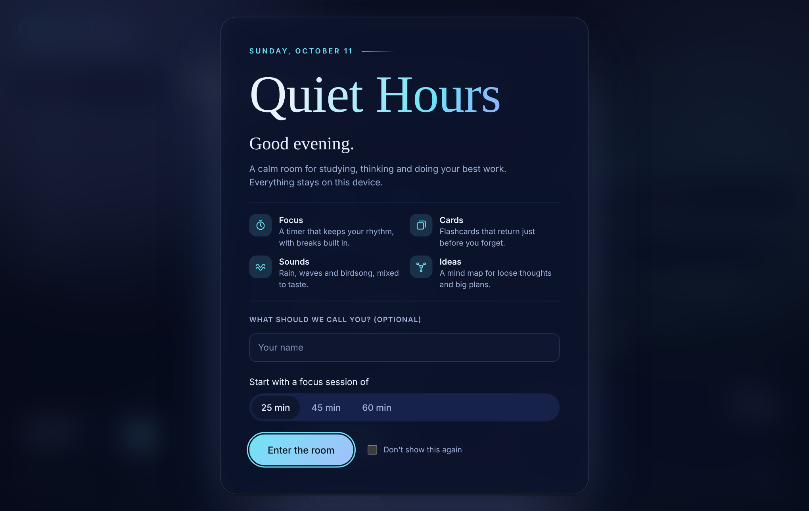

<div align="center">

# Quiet Hours

**A calm room for studying, thinking and doing your best work.**

Focus timer · Notes · Flashcards · Ambient sounds · Mind map · Break games

<br>

[](https://reaperlas.github.io/Quiet-Hours/)


<br>



</div>

<br>

## Overview

Quiet Hours is a study space that runs in your browser. It brings the tools you reach for during a long session into one page: a timer that keeps your rhythm, a place to write, cards that make facts stick, sounds that mask distraction, and a board for loose ideas. There is nothing to install and no account to create.

## Features

### Focus
- Pomodoro timer with adjustable focus, short break and long break lengths. Every fourth focus session earns a long break.
- Optional automatic start of the next session, and a soft bird chirp when time is up.
- A one-line intention for each session and a plan for the day, with sessions counted against each task.
- Full-screen focus mode with a large timer and nothing else.
- Daily totals, a seven-day chart and a streak counter.

### Notes
- Multiple notes with search, word count and autosave.
- Copy a single note, or export all notes as one Markdown file.

### Cards
- Flashcards with spaced repetition. Rate each card Again, Good or Easy, and it returns after 0, 1, 3, 7 or 16 days depending on how well you know it.

### Sounds
- Rain, waves, wind, brown noise, fireplace and birdsong, each with its own volume.
- Three presets: Deep focus, Rainy library and Seaside.
- Master volume and a sleep timer that fades everything out.
- All sound is generated in the browser, so there are no audio files to download.

### Ideas
- A mind map you can drag around, rename, color, auto-arrange and undo.
- Thinking prompts that can be added to the map in one click.

### Break
- Memory match, Echo (repeat the pattern of bird calls), Quick math and a guided breathing exercise.

### Everything else
- A welcome window, with an optional name and a choice of first session length.
- Light and dark themes that follow your device, with a manual switch.
- Layout for desktop and phone.
- Backup and restore of all your data as a single file.

## Screenshots

<table>
  <tr>
    <td width="50%"></td>
    <td width="50%"></td>
  </tr>
  <tr>
    <td align="center"><sub>Light theme</sub></td>
    <td align="center"><sub>Welcome window</sub></td>
  </tr>
</table>

## Getting started

**Use it online.** Open **<https://reaperlas.github.io/Quiet-Hours/>** in any modern browser.

**Run it on your computer.** Download `index.html` and open it in your browser. It is a single self-contained file.

**Add it to your phone.** Open the site, then choose **Add to Home Screen** in Safari or Chrome.

## Shortcuts

| Where | Keys | Action |
| --- | --- | --- |
| Focus | `Space` | Start or pause the timer |
| Anywhere | `Esc` | Close the welcome window or full-screen focus |
| Mind map | `Tab` | Add a child idea to the selected one |
| Mind map | `Enter` | Rename the selected idea |
| Mind map | `Delete` | Remove the selected idea |

## Your data

Notes, cards, tasks, settings and your mind map are stored in your own browser (local storage). Nothing is sent to a server, and there are no accounts. Because the data lives in one browser, a new device starts empty.

To move your data, use **Save backup** at the bottom of the page on one device and **Restore backup** on the other. Clearing your browser's site data will erase your information, so save a backup first.

## Built with

- Plain HTML, CSS and JavaScript in a single file, with no frameworks and no build step.
- The Web Audio API for every sound.
- [Cormorant Garamond](https://fonts.google.com/specimen/Cormorant+Garamond) and [DM Sans](https://fonts.google.com/specimen/DM+Sans) from Google Fonts, the only external request the page makes.

## Project structure

```
Quiet-Hours/
├── index.html      The whole application
├── README.md       This file
└── docs/           Screenshots used in this README
```

## Roadmap

- Optional accounts so notes and cards sync across devices.
- More sounds and more break games.
- Study statistics beyond the seven-day view.

---

<div align="center">

Made by [ReaperLAS](https://github.com/ReaperLAS)

</div>
